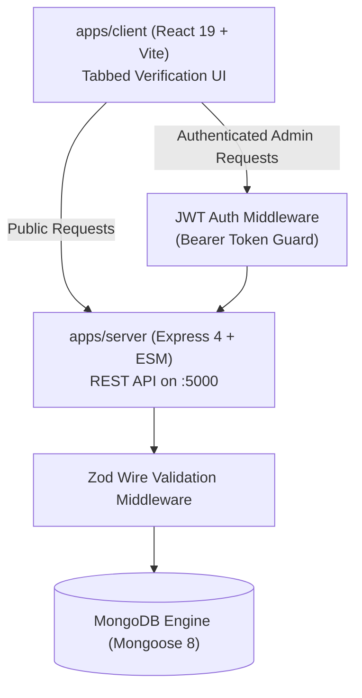

# Product Requirements Document (PRD): Academic Assessment & Leaderboard Engine

**Document Version:** 1.0.0  
**Target Engineers:** Forge (Agent `004` / Lead Software Architect) & Team  
**Author:** Atlas (Agent `003` / Technical Product Manager & Systems Architect)  
**Status:** Approved for Implementation  
**Root Repository:** `/home/mansurul-haque/_practical-test/700002/project/`  

---

## 1. Executive Summary & Architecture Overview

### 1.1 Objective
Deliver a robust, deterministic, and clean Academic Assessment & Leaderboard system. The application allows an administrator to manage students, examinations, and student exam results, while providing a high-performance MongoDB aggregation pipeline for an examination leaderboard.

### 1.2 Monorepo Architecture
The workspace is a `pnpm` monorepo comprising:
- **`apps/server` (Express.js + Mongoose + Zod)**: RESTful API service running on port `5000` (default) with MongoDB connection.
- **`apps/client` (React 19 + Vite)**: Minimal tabbed Single-Page Application (SPA) with zero external UI bloat using vanilla CSS for functional verification and administration.



---

## 2. Technical Stack & Dependencies

### 2.1 Backend (`apps/server`)
- **Runtime:** Node.js (ESM `"type": "module"`)
- **Framework:** Express.js `^4.21.1`
- **Database ODM:** Mongoose `^8.8.0`
- **Validation:** `zod` (`^3.24.x`) for all incoming HTTP request payload validation
- **Authentication & Security:** `jsonwebtoken` (`^9.0.x`) and `bcryptjs` (`^2.4.x`)
- **Environment & Utilities:** `dotenv`, `cors`

### 2.2 Frontend (`apps/client`)
- **Framework:** React `^19.3.1` with Vite `^8.3.6`
- **Styling:** Modular Vanilla CSS (`App.css`, `index.css`)
- **Structure:** Tabbed view pattern (Admin Setup/Login, Students, Exams, Results, Public Leaderboard)

---

## 3. Data Models & Database Invariants

### 3.1 Admin Model (`admins`)
Stores administrator accounts.
```typescript
interface IAdmin {
  _id: string;
  username: string;       // Unique, trimmed, min 3 chars
  email: string;          // Unique, lowercase, trimmed, valid email
  passwordHash: string;   // bcrypt hash (salt rounds: 10)
  createdAt: Date;
  updatedAt: Date;
}
```
**Indexes:**
- `{ email: 1 }` (unique)
- `{ username: 1 }` (unique)

### 3.2 Student Model (`students`)
Stores registered students.
```typescript
interface IStudent {
  _id: string;
  registrationNumber: number; // int64, strictly integer, positive, unique
  name: string;               // trimmed, required, min 1 char
  email: string;              // unique, lowercase, trimmed, valid email format
  batch: string;              // trimmed, required (e.g., "2024", "Fall-2025")
  department: string;         // course department, trimmed, required (e.g., "Computer Science")
  createdAt: Date;
  updatedAt: Date;
}
```
**Indexes:**
- `{ registrationNumber: 1 }` (unique)
- `{ email: 1 }` (unique)
- `{ department: 1 }`
- `{ batch: 1 }`

**Invariants & Constraints:**
- `registrationNumber` must pass `Number.isInteger(val)` and `val > 0`.
- Deletion is **RESTRICTED**: If any `Result` document references `studentId`, deleting this student must return HTTP `409 Conflict`.

### 3.3 Exam Model (`exams`)
Stores examinations.
```typescript
interface IExam {
  _id: string;
  title: string;              // trimmed, required (e.g., "Data Structures Midterm")
  examDate: Date;             // required valid Date
  totalMarks: number;         // required positive number (> 0)
  status: "draft" | "published" | "completed"; // default: "draft"
  createdAt: Date;
  updatedAt: Date;
}
```
**Indexes:**
- `{ status: 1 }`
- `{ examDate: 1 }`

**Invariants & Constraints:**
- `totalMarks` must be `> 0`.
- `status` must be one of `['draft', 'published', 'completed']`.
- Deletion is **RESTRICTED**: If any `Result` document references `examId`, deleting this exam must return HTTP `409 Conflict`.

### 3.4 Result Model (`results`)
Stores student scores for specific exams.
```typescript
interface IResult {
  _id: string;
  studentId: mongoose.Types.ObjectId; // ref: "Student", required
  examId: mongoose.Types.ObjectId;    // ref: "Exam", required
  obtainedMarks: number;             // required, 0 <= obtainedMarks <= exam.totalMarks
  createdAt: Date;
  updatedAt: Date;
}
```
**Indexes:**
- Compound unique index: `{ studentId: 1, examId: 1 }` (unique: true)
- `{ examId: 1 }`

**Invariants & Constraints:**
- A student can have only **one** result record per examination (`studentId` + `examId` is unique).
- `obtainedMarks` must be non-negative: `obtainedMarks >= 0`.
- `obtainedMarks` must not exceed the exam's total marks: `obtainedMarks <= exam.totalMarks`.
- The referenced `Student` and `Exam` must exist in the database; otherwise return HTTP `404 Not Found`.

---

## 4. Standard Request / Response Envelope & Pagination

### 4.1 Success Envelope
All JSON responses must adhere to the standard envelope format:
```json
{
  "success": true,
  "data": { ... },
  "message": "Optional descriptive string"
}
```

### 4.2 Paginated Envelope
Used across all collection listings and the Leaderboard endpoint:
```json
{
  "success": true,
  "data": [ ... ],
  "pagination": {
    "currentPage": 1,
    "limit": 10,
    "totalRecords": 45,
    "totalPages": 5,
    "hasNextPage": true,
    "hasPrevPage": false
  }
}
```

### 4.3 Error Envelope
```json
{
  "success": false,
  "message": "Human-readable error explanation",
  "errors": [
    {
      "field": "obtainedMarks",
      "message": "Obtained marks cannot exceed exam total marks (100)"
    }
  ]
}
```

---

## 5. Authentication & Authorization Specification

### 5.1 Admin Bootstrap (`POST /api/auth/bootstrap`)
- **Access:** Public (First-time initialization only)
- **Logic:**
  1. Check if any document exists in the `Admin` collection (`Admin.countDocuments()`).
  2. If count > 0: Reject immediately with HTTP `409 Conflict` (`"Admin already initialized. Please log in."`).
  3. If count == 0: Validate payload with Zod, hash password with `bcryptjs.hash(password, 10)`, create Admin record.
  4. Return HTTP `201 Created` with admin metadata (excluding `passwordHash`).

### 5.2 Admin Login (`POST /api/auth/login`)
- **Access:** Public
- **Logic:**
  1. Validate email and password via Zod.
  2. Lookup Admin by email. If not found or password does not match `bcryptjs.compare`, return HTTP `401 Unauthorized` (`"Invalid credentials"`).
  3. Issue JWT token containing `{ id: admin._id, email: admin.email, username: admin.username }` signed with `JWT_SECRET` (expiry: `24h`).
  4. Return HTTP `200 OK` with token:
```json
{
  "success": true,
  "data": {
    "token": "<jwt-bearer-token>",
    "admin": {
      "id": "...",
      "username": "superadmin",
      "email": "admin@example.com"
    }
  }
}
```

### 5.3 Authentication Guard Middleware (`authMiddleware`)
- Read header: `Authorization: Bearer <token>`.
- If missing or malformed: return HTTP `401 Unauthorized` (`"Missing or invalid Authorization header"`).
- Verify JWT with `JWT_SECRET`. On failure/expiration: return HTTP `401 Unauthorized` (`"Invalid or expired token"`).
- Attach decoded admin to `req.admin`.
- Route protection:
  - **Public:** `POST /api/auth/bootstrap`, `POST /api/auth/login`, `GET /api/exams/:examId/leaderboard`, `GET /api/health`
  - **Protected (Admin only):** All Student, Exam, and Result CRUD endpoints, `GET /api/auth/me`.

---

## 6. Detailed API Endpoints & Wire Contracts (Zod)

### 6.1 Authentication Endpoints

#### `POST /api/auth/bootstrap`
- **Request Body (Zod):**
  ```typescript
  z.object({
    username: z.string().trim().min(3, "Username must be at least 3 characters"),
    email: z.string().trim().email("Invalid email format").toLowerCase(),
    password: z.string().min(6, "Password must be at least 6 characters")
  })
  ```
- **Responses:**
  - `201 Created`: Admin created.
  - `409 Conflict`: Admin already exists.
  - `400 Bad Request`: Zod validation errors.

#### `POST /api/auth/login`
- **Request Body (Zod):**
  ```typescript
  z.object({
    email: z.string().trim().email("Invalid email format").toLowerCase(),
    password: z.string().min(1, "Password is required")
  })
  ```
- **Responses:**
  - `200 OK`: JWT token returned.
  - `401 Unauthorized`: Bad credentials.

#### `GET /api/auth/me`
- **Guard:** Admin Auth
- **Responses:**
  - `200 OK`: Current admin profile `{ id, username, email }`.

---

### 6.2 Student Management Endpoints (`/api/students`)
*All endpoints protected by `authMiddleware`.*

#### `POST /api/students`
- **Request Body (Zod):**
  ```typescript
  z.object({
    registrationNumber: z.number().int().positive("Registration number must be a positive integer"),
    name: z.string().trim().min(1, "Name is required"),
    email: z.string().trim().email("Invalid email format").toLowerCase(),
    batch: z.string().trim().min(1, "Batch is required"),
    department: z.string().trim().min(1, "Department is required")
  })
  ```
- **Integrity Validation:** Check uniqueness of `registrationNumber` and `email`. If already taken, return `409 Conflict`.
- **Response:** `201 Created` with created student object.

#### `GET /api/students`
- **Query Params:**
  - `page` (optional integer, default `1`)
  - `limit` (optional integer, default `10`)
  - `search` (optional string, matching `name` or `registrationNumber`)
  - `department` (optional string)
  - `batch` (optional string)
- **Response:** `200 OK` with paginated list of students.

#### `GET /api/students/:id`
- **Response:** `200 OK` with student object or `404 Not Found`.

#### `PUT /api/students/:id`
- **Request Body (Zod):** Same as `POST`, or partial with `.partial()`.
- **Integrity Validation:** If `registrationNumber` or `email` changed, ensure no conflict with other students.
- **Response:** `200 OK` with updated student or `404 Not Found`.

#### `DELETE /api/students/:id`
- **Integrity Check:**
  ```javascript
  const resultCount = await Result.countDocuments({ studentId: req.params.id });
  if (resultCount > 0) {
    return res.status(409).json({
      success: false,
      message: "Cannot delete student: Student has existing exam results. Delete results first."
    });
  }
  ```
- **Response:** `200 OK` (`"Student deleted successfully"`) or `404 Not Found`.

---

### 6.3 Exam Management Endpoints (`/api/exams`)
*CRUD endpoints protected by `authMiddleware`.*

#### `POST /api/exams`
- **Request Body (Zod):**
  ```typescript
  z.object({
    title: z.string().trim().min(1, "Title is required"),
    examDate: z.string().datetime().or(z.string().regex(/^\d{4}-\d{2}-\d{2}/)),
    totalMarks: z.number().positive("Total marks must be greater than zero"),
    status: z.enum(["draft", "published", "completed"]).default("draft")
  })
  ```
- **Response:** `201 Created` with created exam object.

#### `GET /api/exams`
- **Query Params:**
  - `page` (optional integer, default `1`)
  - `limit` (optional integer, default `10`)
  - `status` (optional filter: `"draft"` | `"published"` | `"completed"`)
- **Response:** `200 OK` with paginated list of exams.

#### `GET /api/exams/:id`
- **Response:** `200 OK` with exam object or `404 Not Found`.

#### `PUT /api/exams/:id`
- **Request Body (Zod):** Same fields as POST (partial allowed).
- **Integrity Validation:** If `totalMarks` is updated downwards, verify that no existing `Result` for this exam has `obtainedMarks > new totalMarks`. If violated, return `400 Bad Request` explaining the conflict.
- **Response:** `200 OK` with updated exam or `404 Not Found`.

#### `DELETE /api/exams/:id`
- **Integrity Check:**
  ```javascript
  const resultCount = await Result.countDocuments({ examId: req.params.id });
  if (resultCount > 0) {
    return res.status(409).json({
      success: false,
      message: "Cannot delete exam: Examination has recorded student results. Delete results first."
    });
  }
  ```
- **Response:** `200 OK` (`"Exam deleted successfully"`) or `404 Not Found`.

---

### 6.4 Result Management Endpoints (`/api/results`)
*All endpoints protected by `authMiddleware`.*

#### `POST /api/results`
- **Request Body (Zod):**
  ```typescript
  z.object({
    studentId: z.string().regex(/^[0-9a-fA-F]{24}$/, "Invalid student ID"),
    examId: z.string().regex(/^[0-9a-fA-F]{24}$/, "Invalid exam ID"),
    obtainedMarks: z.number().min(0, "Obtained marks cannot be negative")
  })
  ```
- **Business Logic Validations:**
  1. Fetch `Student.findById(studentId)`. If null: return `404 Not Found` (`"Student not found"`).
  2. Fetch `Exam.findById(examId)`. If null: return `404 Not Found` (`"Exam not found"`).
  3. Validate mark range: `if (obtainedMarks > exam.totalMarks)` return `400 Bad Request` (`"Obtained marks (${obtainedMarks}) cannot exceed exam total marks (${exam.totalMarks})"`).
  4. Check uniqueness: `const exists = await Result.findOne({ studentId, examId })`. If exists: return `409 Conflict` (`"A result for this student and exam already exists"`).
- **Response:** `201 Created` with result document.

#### `GET /api/results`
- **Query Params:**
  - `page` (optional integer, default `1`)
  - `limit` (optional integer, default `10`)
  - `examId` (optional ObjectId)
  - `studentId` (optional ObjectId)
- **Response:** `200 OK` with populated student (`registrationNumber`, `name`) and exam (`title`, `totalMarks`) details, paginated.

#### `GET /api/results/:id`
- **Response:** `200 OK` with populated result or `404 Not Found`.

#### `PUT /api/results/:id`
- **Request Body (Zod):**
  ```typescript
  z.object({
    obtainedMarks: z.number().min(0, "Obtained marks cannot be negative")
  })
  ```
- **Business Logic Validations:**
  1. Find result by ID. If not found: return `404 Not Found`.
  2. Find related exam. If `obtainedMarks > exam.totalMarks`, return `400 Bad Request`.
- **Response:** `200 OK` with updated result.

#### `DELETE /api/results/:id`
- **Response:** `200 OK` (`"Result deleted successfully"`) or `404 Not Found`.

---

## 7. Leaderboard Aggregation Pipeline Specification

### 7.1 Access & Overview
- **Endpoint:** `GET /api/exams/:examId/leaderboard`
- **Access:** **PUBLIC** (No authentication required)
- **Query Parameters:**
  - `page`: positive integer (default: `1`)
  - `limit`: positive integer (default: `10`, max: `100`)

### 7.2 Leaderboard Projections Required by PRD
For each student entry in the leaderboard:
1. **`rank`**: Sequential integer (`1, 2, 3, ...`) based on descending obtained marks, tie-broken by registration number ascending.
2. **`registrationNumber`**: Student's unique registration number.
3. **`name`**: Student's full name.
4. **`obtainedMarks`**: Student's obtained marks in the exam.
5. **`totalMarks`**: Total marks of the exam.
6. **`percentage`**: Calculated as `(obtainedMarks / totalMarks) * 100`, rounded to 2 decimal places.

### 7.3 Canonical MongoDB Aggregation Pipeline
Forge should implement the aggregation pipeline directly in the Result model/service as follows:

```javascript
import mongoose from "mongoose";

export async function getExamLeaderboard(examIdString, page = 1, limit = 10) {
  const examId = new mongoose.Types.ObjectId(examIdString);
  const skip = (page - 1) * limit;

  // 1. First verify exam exists and get totalMarks
  const exam = await mongoose.model("Exam").findById(examId).lean();
  if (!exam) {
    return null; // Controller returns 404
  }

  const pipeline = [
    // Step 1: Match all results for this exam
    {
      $match: { examId: examId }
    },
    // Step 2: Lookup Student details
    {
      $lookup: {
        from: "students",
        localField: "studentId",
        foreignField: "_id",
        as: "student"
      }
    },
    {
      $unwind: "$student"
    },
    // Step 3: Sequential Sort (Primary: obtainedMarks desc, Secondary: registrationNumber asc)
    {
      $sort: {
        obtainedMarks: -1,
        "student.registrationNumber": 1
      }
    },
    // Step 4: Window Fields to assign 1-based sequential rank
    {
      $setWindowFields: {
        sortBy: { obtainedMarks: -1, "student.registrationNumber": 1 },
        output: {
          rank: { $documentNumber: {} }
        }
      }
    },
    // Step 5: Projection with calculation of percentage
    {
      $project: {
        _id: 1,
        rank: 1,
        registrationNumber: "$student.registrationNumber",
        name: "$student.name",
        batch: "$student.batch",
        department: "$student.department",
        obtainedMarks: 1,
        totalMarks: { $literal: exam.totalMarks },
        percentage: {
          $round: [
            {
              $multiply: [
                { $divide: ["$obtainedMarks", exam.totalMarks] },
                100
              ]
            },
            2
          ]
        }
      }
    },
    // Step 6: Facet for standard pagination and count
    {
      $facet: {
        metadata: [{ $count: "totalRecords" }],
        records: [{ $skip: skip }, { $limit: limit }]
      }
    }
  ];

  const [result] = await mongoose.model("Result").aggregate(pipeline);
  const totalRecords = result.metadata[0]?.totalRecords || 0;
  const totalPages = Math.ceil(totalRecords / limit) || 1;

  return {
    exam: {
      id: exam._id,
      title: exam.title,
      totalMarks: exam.totalMarks,
      examDate: exam.examDate,
      status: exam.status
    },
    leaderboard: result.records,
    pagination: {
      currentPage: page,
      limit: limit,
      totalRecords: totalRecords,
      totalPages: totalPages,
      hasNextPage: page < totalPages,
      hasPrevPage: page > 1
    }
  };
}
```

---

## 8. Minimal Verification Frontend (`apps/client`)

### 8.1 Functional Scope & Philosophy
The React UI acts as an intuitive, zero-dependency functional verification dashboard. It does not require complex routing libraries or heavy UI component frameworks.

### 8.2 UI Layout: Tabbed Single-Page Application
A header navigation bar switches between 5 active tabs:
1. **Tab 1: Admin Auth / Setup**
   - Bootstrap Admin section: Form with `Username`, `Email`, `Password`, "Initialize Admin" button. Disabled/hidden once initialized.
   - Login section: Form with `Email`, `Password`, "Login" button.
   - Active Session banner: Shows currently logged-in admin email and a "Logout" button. Persists token in `localStorage`.
2. **Tab 2: Students**
   - Create/Edit Student form: `Registration Number` (number), `Name`, `Email`, `Batch`, `Department`.
   - Paginated Student table with columns: Reg No, Name, Email, Batch, Department, Actions (Edit, Delete).
   - "Next / Prev" pagination buttons.
3. **Tab 3: Exams**
   - Create/Edit Exam form: `Title`, `Exam Date`, `Total Marks`, `Status` dropdown (`draft`, `published`, `completed`).
   - Paginated Exam table with columns: Title, Exam Date, Total Marks, Status, Actions (Edit, Delete).
4. **Tab 4: Results**
   - Record Result form: Student dropdown (or Reg No selector), Exam dropdown, `Obtained Marks` input, "Submit Result" button.
   - Client-side pre-validation: displays the selected exam's total marks and prevents entering marks > total.
   - Paginated Results table with Edit and Delete controls.
5. **Tab 5: Public Leaderboard**
   - Exam selection dropdown (lists published & completed exams).
   - Paginated Leaderboard Table:
     - **Columns:** Rank `#`, Reg No, Student Name, Obtained Marks, Total Marks, Percentage (`%`).
     - Visual badge highlighting Top 3 ranks (`#1 Gold`, `#2 Silver`, `#3 Bronze`).
   - Accessible without admin authentication.

---

## 9. Implementation Checklist & Acceptance Criteria for Forge

### 9.1 Phase 1: Backend Infrastructure & Auth (Port `5000`)
- [ ] Install missing dependencies in `apps/server`: `pnpm --filter server add zod jsonwebtoken bcryptjs`.
- [ ] Define Mongoose models: `Admin`, `Student`, `Exam`, `Result` with explicit types and unique indexes.
- [ ] Implement `POST /api/auth/bootstrap` (creates first admin; throws 409 if already initialized).
- [ ] Implement `POST /api/auth/login` and JWT verification middleware `authMiddleware`.
- [ ] Implement standardized error-handling middleware catching Zod validation errors, Mongoose duplicate key errors (`11000`), and conflict errors.

### 9.2 Phase 2: CRUD Endpoints & Referential Integrity
- [ ] Implement Student CRUD with unique `registrationNumber` and `email` checks.
- [ ] Implement Exam CRUD with status enum and totalMarks validation.
- [ ] Implement Result CRUD with duplicate `(studentId, examId)` guard and mark range checks (`0 <= obtainedMarks <= exam.totalMarks`).
- [ ] Enforce **Deletion Restrictions**: Block deleting Student/Exam if associated Results exist (HTTP `409`).
- [ ] Implement query-string pagination (`page`, `limit`) across all GET collection endpoints.

### 9.3 Phase 3: Leaderboard Aggregation Pipeline
- [ ] Implement public endpoint `GET /api/exams/:examId/leaderboard`.
- [ ] Execute MongoDB `$setWindowFields` / `$facet` pipeline yielding sequential rank, projection, and percentage.
- [ ] Verify sorting by `obtainedMarks` desc and `registrationNumber` asc.

### 9.4 Phase 4: Functional Verification React UI
- [ ] Connect `apps/client` to `http://localhost:5000/api` (via Vite proxy or direct fetch with CORS).
- [ ] Build clean, lightweight Tabbed SPA (`Auth`, `Students`, `Exams`, `Results`, `Leaderboard`).
- [ ] Verify end-to-end user journey: Bootstrap Admin -> Create Students -> Create Exam -> Record Results -> View Leaderboard.

---

## 10. Verification Script & Test Scenarios

Forge can verify the entire backend lifecycle using this test scenario:
1. **Bootstrap Admin:**
   `POST /api/auth/bootstrap` with `{ username: "admin", email: "admin@test.com", password: "password123" }` -> Returns `201`.
   Second call with same payload -> Returns `409 Conflict`.
2. **Login Admin:**
   `POST /api/auth/login` -> Returns JWT token.
3. **Create Students:**
   Create Student A (`reg: 1001`), Student B (`reg: 1002`), Student C (`reg: 1003`).
   Duplicate reg number creation -> Returns `409 Conflict`.
4. **Create Exam:**
   Create Exam (`title: "Algorithms Final"`, `totalMarks: 100`, `status: "published"`).
5. **Record Results:**
   - Student A: 95 marks.
   - Student B: 90 marks.
   - Student C: 90 marks.
   - Invalid mark (105 / 100) -> Returns `400 Bad Request`.
   - Duplicate result for Student A -> Returns `409 Conflict`.
6. **Query Leaderboard:**
   `GET /api/exams/:examId/leaderboard` -> Returns:
   - Rank 1: Student A (95 / 100, 95.00%)
   - Rank 2: Student B (90 / 100, 90.00%)
   - Rank 3: Student C (90 / 100, 90.00%)
7. **Referential Integrity Check:**
   `DELETE /api/students/:id` -> Returns `409 Conflict` (results attached).
